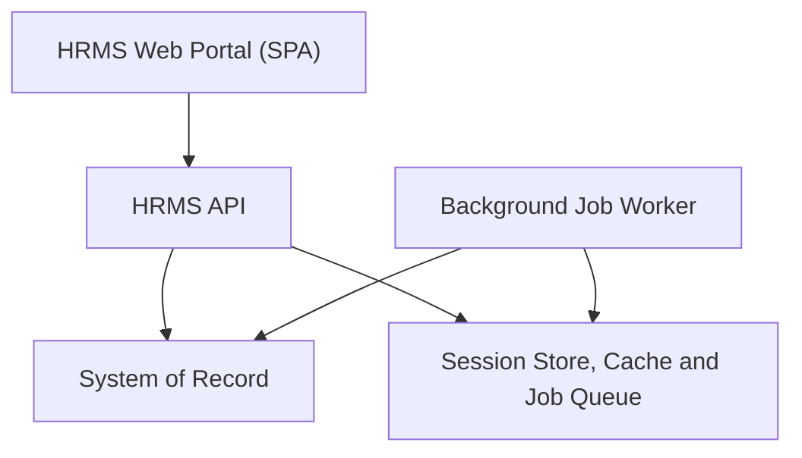
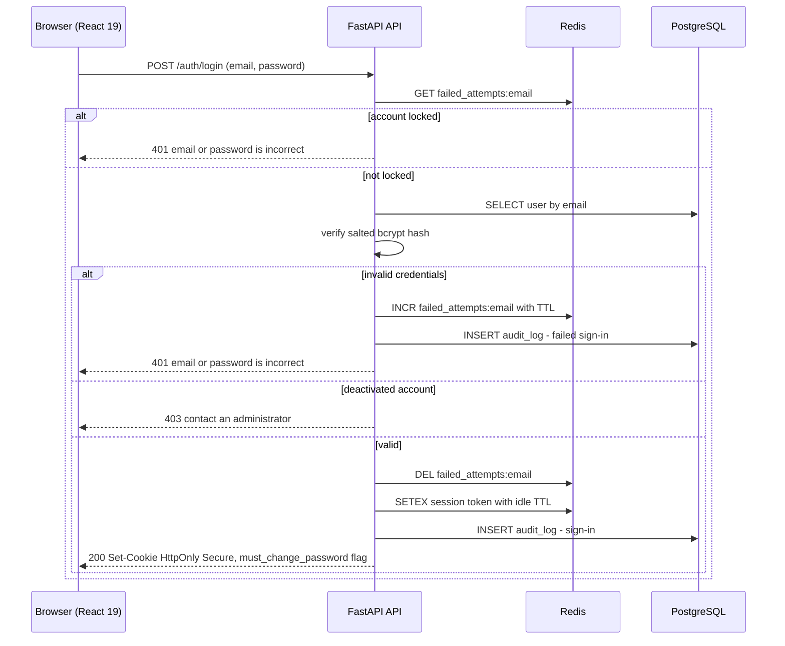
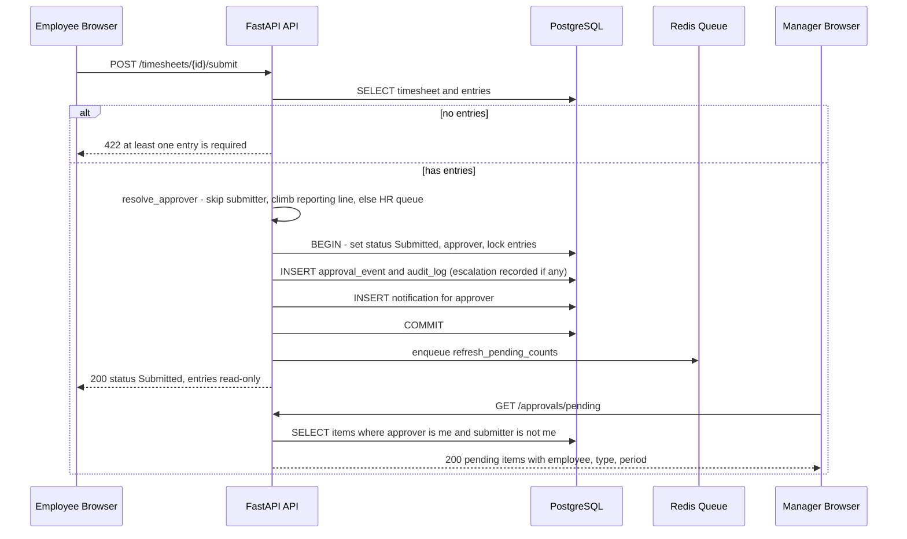
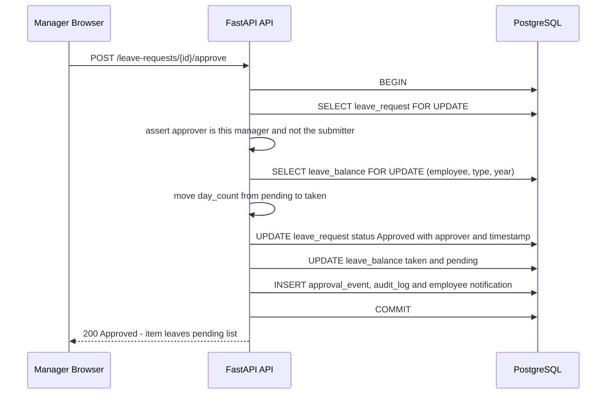
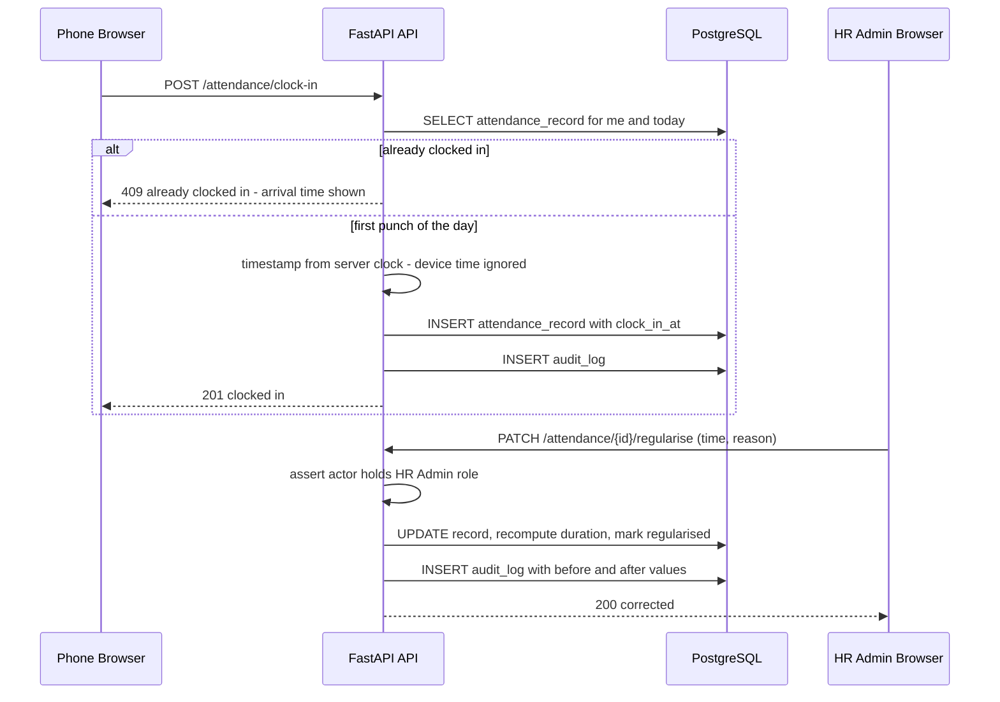
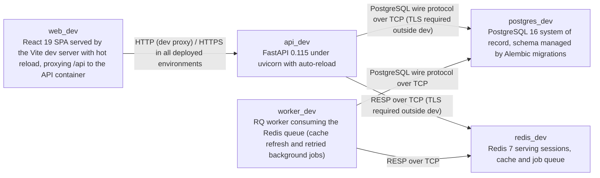

# Architecture

> Maintained by QuorQ AI SDLC. Text between `sdlc:auto` markers is regenerated; anything outside them is yours and is kept.

<!-- sdlc:auto:start narrative -->
## Overview

### ARCH-001 · approved · source: architecture:v1:summary

Single-organisation HRMS portal. A React 19 SPA calls a FastAPI 0.115 REST API over HTTPS, with PostgreSQL 16 as system of record and Redis 7 for sessions, cache and job queue. Scope is deliberately lightweight.

- Architecture version 1, status approved.
- PostgreSQL 16 holds people, projects, timesheets, attendance, leave and an append-only audit log.
- Redis 7 has two approved roles: server-side sessions (idle timeout, sign-out and lockout enforced centrally) and caching of heavier dashboard aggregates. It also backs a small job queue for work that should not block a request.
- Every request is authorised on the server by role AND relationship (own record, direct reports, own projects, HR scope).
- Self-approval is blocked by routing a submitter's item to the next manager up or to the HR Admin queue.
- Leave balance changes run in a single DB transaction with row-level locking, so an approval and an HR correction cannot double-deduct.
- The whole stack runs in one managed AWS region inside the company's country. RDS has daily automated snapshots and point-in-time restore. KMS encrypts data at rest and TLS in transit, supporting the data-residency and personal-data promises to staff.
- Explicitly out of scope: email, bulk import, reporting dashboards, SSO.

**Related:** NFR-008, NFR-012, NFR-015

- ⚠ Input does not say who approved the architecture or when.
- ⚠ The summary says Redis has 'two approved roles' but the Redis component also lists the job queue as a third function. Confirm the intended count.
- ⚠ NFR-008, NFR-012 and NFR-015 are cited but their definitions were not provided.

### ARCH-COMP-WEB · approved · source: architecture:v1:components:web_app

HRMS Web Portal: a responsive React 19 SPA serving all five roles. It renders navigation only from the union of the signed-in user's roles; this is presentation only, and the server remains the authority.

- Screens/functions listed: sign-in, home dashboard, weekly timesheet grid, clock-in/out, leave requests and balances, holiday calendar, approval queue, HR and admin screens, in-app alerts, help pages.
- Navigation and dashboard are built from the permissions returned by GET /api/me.
- The same build serves a 360px phone browser for clock-in.

- ⚠ No requirement ids are linked to this component in the input.

### ARCH-COMP-API · approved · source: architecture:v1:components:api

HRMS API (FastAPI 0.115): holds all business rules and is the only writer to the database.

Responsibilities:
- Authentication and session lifecycle.
- Role+relationship authorisation on every request.
- Employee, department and project records.
- Timesheet entry and submission.
- Attendance punches stamped from the server clock.
- Leave day-count and balance arithmetic.
- Single-step approval with self-approval escalation.
- In-app notifications.
- Append-only audit logging of every approval, rejection, correction and administrative action.

**Related:** NFR-010

### ARCH-COMP-WORKER · approved · source: architecture:v1:components:worker

Background Job Worker: a Python 3.12 RQ worker built from the same FastAPI 0.115 codebase. It runs work off the request path.

- Consumes the Redis-backed job queue.
- Recomputes cached dashboard and pending-count aggregates after approvals.
- Retries failed jobs.
- Shares the API's domain modules so rules are not duplicated.

- ⚠ Retry policy (attempts, backoff) and failure handling for jobs that keep failing are not specified.

### ARCH-COMP-DB · approved · source: architecture:v1:components:db

PostgreSQL 16 is the system of record. It enforces referential integrity and uniqueness and provides transactional, row-locked balance updates.

- Stores employees, departments, reporting lines, projects and assignments, timesheets and entries, attendance punches, leave types/balances/requests, holidays, notifications and the append-only audit log.
- Encrypted at rest and backed up daily with point-in-time restore.
- Schema managed by Alembic migrations (dev node).

**Related:** NFR-008, NFR-012

- ⚠ Backup retention period and RPO/RTO are not stated.

### ARCH-COMP-REDIS · approved · source: architecture:v1:components:redis

Redis 7 (redis:7-alpine) is the session store, cache and job queue. It holds no system-of-record data and no special-category data.

- Opaque server-side sessions: idle timeout, immediate invalidation on sign-out, failed-attempt counters for lockout.
- Caches heavier read aggregates for dashboards and pending lists.
- Carries the background job queue.

**Related:** NFR-001, NFR-002

- ⚠ Session idle TTL value and lockout threshold/duration are not specified.
- ⚠ Redis persistence/availability behaviour is not described. A Redis loss would affect sessions and lockout counters.

### ARCH-PATH-AUTH · approved · source: architecture:v1:critical_paths:sign-in

Sign-in, lockout and server-side session: email+password login with a single generic failure message, Redis-counted lockout, and opaque Redis sessions.

- Failed sign-in returns one generic message.
- Consecutive failures are counted in Redis to lock the account.
- Deactivated accounts are refused with a 'contact an administrator' message.
- On success an opaque session is created in Redis with an idle TTL.
- A password change is forced when the hash was set by an administrator reset.
- Password is verified against a salted bcrypt hash and never logged.

**Related:** NFR-001, NFR-002, NFR-005

- ⚠ No user story ids are linked in the input for this path (only NFR-001, NFR-002, NFR-005).

### ARCH-PATH-TIMESHEET · approved · source: architecture:v1:critical_paths:timesheet-submission

Timesheet submission with no-self-approval routing: validate, lock, route to an approver by relationship, and escalate when the submitter is their own approver.

- Submission requires at least one entry.
- Entries lock read-only on submission.
- The approver is chosen by relationship.
- If the submitter is their own approver, the item escalates up the reporting line or to the HR Admin queue.
- Both the submission and the escalation are written to the audit log.

**Related:** US-018, US-033, NFR-004, NFR-010

- ⚠ Behaviour when no one above the submitter exists and no HR Admin is configured is not specified.

### ARCH-PATH-LEAVE · approved · source: architecture:v1:critical_paths:leave-approval

Leave request day-count, balance check and transactional approval, safe against simultaneous HR corrections.

- Deducted days exclude weekends and holiday-calendar dates.
- 0.5-day minimum is supported.
- Overlaps and over-draws are rejected unless an HR Admin override is applied.
- Submitted days are held as pending.
- On approval, pending moves to taken inside one transaction using SELECT FOR UPDATE on the balance row, so a simultaneous HR correction cannot double-deduct.
- The input cites US-023..US-026, recorded here as US-023 to US-026.

**Related:** US-023, US-024, US-025, US-026, US-031, NFR-015

### ARCH-PATH-ATTENDANCE · approved · source: architecture:v1:critical_paths:clock-in-out

Browser clock-in/clock-out stamped from the server clock, with HR-only regularisation of missing punches.

- Punches use the server clock, never the device clock.
- One clock-in and one clock-out per calendar day.
- No location or device check.
- Days with a clock-in but no clock-out are flagged incomplete with no duration.
- Only an HR Admin may set a missing time, with a reason. This recalculates duration and writes before/after values to the audit log.

**Related:** US-020, US-021, US-022, NFR-006, NFR-010

- ⚠ Handling of shifts crossing midnight is not addressed. The one-punch-pair-per-calendar-day rule implies it is not supported, but this is not stated.

### ARCH-DATA · approved · source: architecture:v1:entities

15 entities cover identity/RBAC, organisation, projects, timesheets, attendance, leave, holidays, approvals, notifications and audit.

- users: id, employee_id, email, password_hash, must_change_password, is_active, failed_login_count, locked_at, last_login_at, created_at
- roles: id, code, name; user_roles: user_id, role_id, granted_at
- departments: id, name, created_at
- employees: id, employee_number, full_name, work_email, mobile_number, personal_contact, department_id, reporting_manager_id, start_date, end_date, is_active, is_erased, erased_at, updated_at
- projects: id, code, name, project_manager_id, start_date, status, created_at
- project_assignments: id, project_id, employee_id, allocated_hours, assigned_on, unassigned_on, is_active
- timesheets: id, employee_id, week_start_date, status, submitted_at, approver_user_id, escalated_to_hr, decided_at, decision_comment, total_hours
- timesheet_entries: id, timesheet_id, project_id, work_date, hours
- attendance_records: id, employee_id, work_date, clock_in_at, clock_out_at, worked_minutes, is_regularised, regularised_by_user_id, regularisation_reason
- leave_types: id, name, annual_entitlement_days, is_unpaid, is_active
- leave_balances: id, employee_id, leave_type_id, year, entitlement_days, taken_days, pending_days, updated_at
- leave_requests: id, employee_id, leave_type_id, start_date, end_date, half_day_portion, day_count, reason, status, approver_user_id, escalated_to_hr, decided_at, decision_comment, override_by_user_id, created_at
- holidays: id, holiday_date, name, year
- approval_events: id, item_type, item_id, actor_user_id, from_status, to_status, comment, created_at
- notifications: id, user_id, kind, message, item_type, item_id, is_read, created_at
- audit_logs: id, actor_user_id, action, entity_type, entity_id, before_values, after_values, reason_or_comment, created_at

Constraints stated in the technology decisions: one punch pair per employee per day, one timesheet per employee per week, one account per email. Audit log is INSERT/SELECT-only with a trigger refusing UPDATE and DELETE; before/after values are jsonb.

- ⚠ Status value sets for timesheets and leave_requests (e.g. Draft/Submitted/Approved/Rejected) are only partly implied by endpoint text and not enumerated.
- ⚠ The five role codes are not listed in the entities. The endpoint text says 'five fixed roles'.
- ⚠ Only Draft, Submitted, approved and rejected-as-draft are implied. Whether rejected items keep a distinct status is unclear.
- ⚠ How employees.is_erased interacts with audit_logs (which keeps who erased and when) is described only at a high level.

### ARCH-API-AUTH-ADMIN · approved · source: architecture:v1:endpoints:auth-admin

Authentication, identity and system-admin endpoints: sign-in/out, password change, current user, user administration and audit-log reading.

- POST /api/auth/login: work email + password. Generic failure message. Deactivated and locked accounts refused. Failed attempts counted toward lockout.
- POST /api/auth/logout: invalidates the server-side session immediately, including via browser back.
- POST /api/auth/change-password: required before any other screen when an administrator issued a one-time password.
- GET /api/me: current user, linked employee record, union of permissions from all held roles.
- POST /api/admin/users: create an account linked to an employee with one or more of the five fixed roles. Duplicate email rejected. Audit-logged.
- PATCH /api/admin/users/{user_id}: activate, deactivate, change roles, unlock. Every change audit-logged.
- POST /api/admin/users/{user_id}/password-reset: generates a one-time password returned once for secure hand-off and replaces the stored hash.
- GET /api/admin/audit-logs: filter by actor, entity, action or date range. No write, update or delete verb exists.

**Related:** NFR-001, NFR-002, NFR-005, NFR-010

- ⚠ No password policy (length/complexity/expiry) is specified.
- ⚠ No self-service forgotten-password flow is listed. Only administrator reset exists.
- ⚠ No user story ids are linked to these endpoints in the input.

### ARCH-API-PEOPLE-PROJECTS · approved · source: architecture:v1:endpoints:employees-departments-projects

Endpoints for employee records, departments, team view and project/assignment management, with relationship-scoped access.

- GET /api/employees: HR Admin sees the organisation, a Reporting Manager sees only direct reports, anyone else is refused.
- POST /api/employees: create with name, employee number, work email, department, reporting manager, start date.
- PATCH /api/employees/{id}: HR Admin edits a record, or the employee edits their own permitted contact fields. Department, reporting manager and employee number are HR-only. Field-level before/after values audit-logged.
- POST /api/employees/{id}/erase: irreversibly erases a leaver's identifying personal fields on request. The audit entry of who erased and when survives.
- GET /api/departments: single shared list.
- POST /api/departments: add a department. Deletion is refused while employees are assigned, naming the count.
- GET /api/my/team: exactly the employees whose reporting manager is the caller, with department and current timesheet/leave status.
- GET /api/projects: projects a Project Manager manages, or (for employees) their own active assignments. Requesting a project not managed is refused.
- POST /api/projects: create with name, code, start date, status.
- POST /api/projects/{id}/assignments: assign an employee to a managed project with optional allocated hours. Assigning to another manager's project is refused.
- DELETE /api/projects/{id}/assignments/{assignment_id}: unassign. The project leaves the employee's picker for new entries while recorded hours are retained.
- GET /api/my/projects: active projects the caller is assigned to, with name, code and status.

- ⚠ A department delete endpoint is not listed, yet deletion behaviour is described under POST /api/departments.
- ⚠ No endpoint is listed for editing or closing a project, or for editing assignment allocated hours after creation.
- ⚠ No endpoint is listed for employees to view or edit their own profile beyond PATCH /api/employees/{id}.
- ⚠ The role description grants Project Managers 'monitor project utilization and allocated hours' and 'review project-specific timesheets'. No dedicated endpoint for these is listed.
- ⚠ The role description grants HR Admin 'manage departments' and Reporting Managers 'monitor team availability'. Only team status is covered (GET /api/my/team).

### ARCH-API-TIME-ATTENDANCE · approved · source: architecture:v1:endpoints:timesheets-attendance

Endpoints for the weekly timesheet grid, draft save and submission, and for clock-in/out, attendance history and HR regularisation.

- GET /api/timesheets: my timesheet periods with status, decision date, manager comment.
- GET /api/timesheets/week/{week_start}: weekly grid with a row per assigned project, a column per day, and row, column and week totals.
- PUT /api/timesheets/week/{week_start}/entries: save draft cells. Rejects negative or non-numeric hours and any day whose total would exceed 24 hours.
- POST /api/timesheets/{id}/submit: requires at least one entry. Status becomes Submitted, entries lock, and the item is routed to the approver (never the submitter).
- POST /api/attendance/clock-in: server-clock stamp, one per calendar day, no location/device check.
- POST /api/attendance/clock-out: server-clock stamp and returns the worked duration.
- GET /api/attendance: my history with arrival, departure and duration, incomplete punches flagged. HR Admin may query all employees for a date.
- PATCH /api/attendance/{id}/regularise: HR correction with a mandatory reason. Marks the record regularised, recalculates duration, audit-logs before/after.

**Related:** US-018, US-020, US-021, US-022, NFR-006, NFR-010

- ⚠ Hours granularity (decimal places) for timesheet cells is not stated.
- ⚠ The project description mentions daily/weekly timesheets. Only a weekly grid is specified (daily entry is via day columns).
- ⚠ No endpoint is listed for HR-wide attendance reports beyond the single-date query.

### ARCH-API-LEAVE · approved · source: architecture:v1:endpoints:leave-holidays

Endpoints for applying for leave, history and balances, HR balance/leave-type administration and the holiday calendar.

- POST /api/leave-requests: apply by active type and date range with optional half-day portion. Excludes weekends and holidays. Refuses reversed dates, overlaps and over-draws unless an HR override is applied.
- GET /api/leave-requests: my history, most recent first, filterable by leave type and status, showing decision date and manager comment.
- GET /api/leave-balances: per leave type, entitlement, taken, pending and remaining for the current year.
- PUT /api/admin/leave-balances/{employee_id}/{leave_type_id}: set or adjust an opening balance. Old and new values audit-logged.
- POST /api/admin/leave-types: create or update a leave type with annual entitlement, unpaid flag and active flag.
- GET /api/holidays: shared company holiday calendar for a year, with date, weekday and name.
- POST /api/admin/holidays: add, edit or remove a holiday date. Takes effect for future leave day-counts and is audit-logged.

**Related:** US-023, US-024, US-025, US-026, US-031, NFR-015

- ⚠ No endpoint is listed for an employee to cancel or withdraw a pending leave request, although the project description says to 'track requests'.
- ⚠ How an HR override is supplied on POST /api/leave-requests (field or separate call) is not specified.
- ⚠ Carry-forward or year-rollover of leave balances is not described.
- ⚠ Single shared holiday calendar: regional or per-location calendars are not supported or discussed.

### ARCH-API-APPROVALS · approved · source: architecture:v1:endpoints:approvals-notifications-dashboard

Endpoints for the unified approval queue, approve/reject/reopen decisions, in-app notifications and the home dashboard.

- GET /api/approvals/pending: one list of timesheets and leave requests awaiting my decision. Never includes my own submissions or items outside my relationship scope.
- POST /api/approvals/{item_type}/{item_id}/approve: a timesheet locks. A leave request moves its days from pending to taken in one transaction. Audit-logged and notified in-app.
- POST /api/approvals/{item_type}/{item_id}/reject: mandatory comment. The item returns to the employee as an editable draft and no leave days are deducted.
- POST /api/approvals/{item_type}/{item_id}/reopen: HR reopen of an approved item with a reason. A timesheet returns to Draft; a leave request returns its deducted days. Reversal audit-logged with previous status.
- GET /api/notifications: my in-app alerts with unread count. No email, SMS or push channel exists.
- POST /api/notifications/{id}/read: mark read and decrement the unread count.
- GET /api/dashboard: current timesheet status, today's clock-in state, remaining leave balances, pending leave requests, and a pending-approval count when the caller holds an approving role.

**Related:** US-033, NFR-004, NFR-010, NFR-015

- ⚠ Approval is single-step only. Multi-level approval is not supported.
- ⚠ The project description asks for approval 'notifications'. The architecture provides in-app alerts only, with no email/SMS/push. Confirm this meets the requirement.
- ⚠ Manager behaviour when away or unavailable (delegation) is not described.

### ARCH-DEPLOY · approved · source: architecture:v1:deployment_nodes,technology_decisions:cloud

Five development nodes are specified, all containers. The target cloud is AWS in a single in-country region, but no production node topology is itemised in the deployment nodes.

Development nodes:
- web_dev: React 19 SPA via Vite dev server with hot reload, proxying /api to the API container (Node 20 container; build output is static files).
- api_dev: FastAPI 0.115 under uvicorn with auto-reload, Python 3.12 container.
- worker_dev: RQ worker consuming the Redis queue (cache refresh and retried jobs), same image as api_dev.
- postgres_dev: PostgreSQL 16 (postgres:16) with a named volume; schema managed by Alembic.
- redis_dev: Redis 7 (redis:7-alpine), port 6379.

AWS target (from the cloud decision): CloudFront-fronted S3, ECS Fargate tasks, RDS and ElastiCache in one in-country region. RDS daily automated snapshots with point-in-time restore, KMS encryption at rest, TLS in transit, and Secrets Manager for DB and Redis credentials.

**Related:** NFR-008, NFR-012

- ⚠ Production/staging deployment nodes are not itemised. Only dev nodes are listed.
- ⚠ The specific AWS region/country is not named.
- ⚠ The dev nodes use a Redis container while the cloud decision names ElastiCache. This is consistent in intent but not explicitly mapped.
- ⚠ No CI/CD, environment promotion, monitoring or logging approach is described.

### ARCH-TD-FRONTEND · approved · source: architecture:v1:technology_decisions:frontend

Frontend: React 19 chosen over Vue 3, Angular 18 and server-rendered Jinja templates.

Rationale given:
- One responsive component set covers all five roles. Navigation and dashboard render from /api/me permissions, so a user holding Employee plus Reporting Manager sees both their own summary and the approval count in the same shell.
- Interactive parts suit React's component/state model: the week-by-project timesheet grid with live totals, the leave date-range picker with non-working-day breakdown, and the filterable approval queue.
- The same build serves a 360px phone browser for clock-in.

### ARCH-TD-BACKEND · approved · source: architecture:v1:technology_decisions:backend

Backend: FastAPI 0.115 chosen over Django REST Framework, Flask and Express.

Rationale given:
- System weight is rules, not throughput, and all land in the API: relationship-scoped authorisation as one shared dependency on every route, self-approval escalation, half-day leave arithmetic that skips weekends and holidays, and transactional balance updates.
- FastAPI dependency injection expresses 'resolve session, union the roles, narrow by relationship' once and attaches it everywhere.
- Pydantic models give edge validation needed by AC-054 and AC-055.
- Python decimal and date handling keeps 0.5-day leave maths exact.

**Related:** AC-054, AC-055

- ⚠ AC-054 and AC-055 are cited but are not in the supplied requirement keys, and their content was not provided.

### ARCH-TD-DATABASE · approved · source: architecture:v1:technology_decisions:database

Database: PostgreSQL 16 chosen over MySQL 8, SQL Server and MongoDB.

Rationale given:
- Data is tightly related (employees to managers to projects to timesheet lines to balances), so foreign keys and unique constraints carry business rules: one punch pair per employee per day, one timesheet per employee per week, one account per email.
- NFR-015 is met with SELECT FOR UPDATE inside a single transaction when an approval and an HR correction collide.
- Append-only audit log is a plain table with INSERT/SELECT-only grants and a trigger refusing UPDATE and DELETE; jsonb holds before/after values. Queries stay fast at the expected volume.

**Related:** NFR-015

- ⚠ Expected data volume and user count are referenced ('at this volume') but not stated.

### ARCH-TD-CLOUD · approved · source: architecture:v1:technology_decisions:cloud

Cloud: AWS chosen over Azure, Google Cloud and on-premise hosting.

Rationale given:
- Data residency is kept by running every node (CloudFront-fronted S3, ECS Fargate, RDS, ElastiCache) in one in-country region. AWS has the widest spread of in-country regions.
- NFRs delivered as managed features: RDS daily snapshots with point-in-time restore (NFR-012), KMS encryption at rest and TLS in transit (NFR-008), Secrets Manager for DB and Redis credentials.

**Related:** NFR-008, NFR-012

- ⚠ The company's country and the chosen region are not named, so the in-country claim cannot be verified from the input.

### ARCH-SEC-SCOPE · approved · source: architecture:v1:summary,endpoints,project-description

Cross-cutting authorisation, audit and scope boundaries, with discrepancies against the project description.

- Authorisation: server-side on every request using role AND relationship. The UI hides navigation but is not the authority.
- Self-approval is blocked by escalation up the reporting line or to the HR Admin queue.
- Audit: append-only for approvals, rejections, reopens, corrections, erasures and admin actions.
- Notifications are in-app only.
- Excluded by design: email, bulk import, reporting dashboards, SSO.
- Project description lists five roles: Employee, Reporting Manager, HR Admin, Project Manager, System Admin. The architecture models them as five fixed roles with a union of permissions for users holding several.

**Related:** NFR-004, NFR-010

- ⚠ Discrepancy: the project description's headline names four groups (Employees, Managers, HR, Admins) but its permissions table lists five roles (adds Project Manager). The architecture follows five.
- ⚠ Conflict: the permissions table gives Reporting Managers 'access team reports' and HR Admin 'organization-wide HR reports'. The architecture excludes reporting dashboards and lists no report endpoints. Confirm whether a limited report is intended.
- ⚠ The project description text is truncated at 'RBAC Requirements ... 2. Employees can', so RBAC requirements beyond item 1 could not be traced.
- ⚠ The description lists 'attendance records' for HR Admin. Only a per-date attendance query and regularisation are specified.
- ⚠ No endpoint covers role/permission management beyond assigning the five fixed roles, although System Admin is described as managing 'permissions' and 'organization settings and system configurations'. No settings endpoint is listed.
- ⚠ US-001 to US-040 are known requirement keys, but the architecture input only cites US-018, US-020 to US-026, US-031 and US-033. The remaining stories have no explicit architecture linkage in the input.
<!-- sdlc:auto:end narrative -->

<!-- sdlc:auto:start building-blocks -->
## Building Block View

| ID | Name | Technology | Responsibility | Depends on |
|---|---|---|---|---|
| web_app | HRMS Web Portal (SPA) | React 19 | Responsive single-page interface for all five roles: sign-in, home dashboard, weekly timesheet grid, clock-in/out, leave requests and balances, holiday calendar, approval queue, HR and admin screens, in-app alerts and help pages. Renders only the navigation permitted by the union of the signed-in user's roles (presentation only - the server remains the authority). | api |
| api | HRMS API | FastAPI 0.115 | All business rules and the only writer to the database: authentication and session lifecycle, role+relationship authorisation on every request, employee/department/project records, timesheet entry and submission, attendance punches stamped from the server clock, leave day-count and balance arithmetic, single-step approval with self-approval escalation, in-app notifications, and append-only audit logging of every approval, rejection, correction and administrative action. | db, redis |
| worker | Background Job Worker | Python 3.12 RQ worker (same FastAPI 0.115 codebase) | Consumes the Redis-backed job queue to run work off the request path: recomputing cached dashboard and pending-count aggregates after approvals, and retrying jobs that fail. Shares the API's domain modules so rules are never duplicated. | db, redis |
| db | System of Record | PostgreSQL 16 | Stores employees, departments, reporting lines, projects and assignments, timesheets and entries, attendance punches, leave types/balances/requests, holidays, notifications and the append-only audit log. Enforces referential integrity and uniqueness, and provides transactional, row-locked balance updates. Encrypted at rest and backed up daily with point-in-time restore (NFR-008, NFR-012). | — |
| redis | Session Store, Cache and Job Queue | Redis 7 (redis:7-alpine) | Holds opaque server-side sessions (idle timeout, immediate invalidation on sign-out, failed-attempt counters for lockout), caches heavier read aggregates used by dashboards and pending lists, and carries the background job queue. Contains no system-of-record data and no special-category data. | — |

<!-- sdlc:auto:end building-blocks -->

<!-- sdlc:auto:start runtime -->
## Runtime View

### Sign-in, lockout and server-side session

Email+password sign-in that returns one generic failure message, counts consecutive failures in Redis to lock the account, refuses deactivated accounts with a 'contact an administrator' message, creates an opaque session in Redis with an idle TTL, and forces a password change when the hash was set by an administrator reset. Password is verified against a salted bcrypt hash and never logged (NFR-001, NFR-002, NFR-005).

- **Components:** web_app, api, db, redis
- **Modules:** auth.router, auth.service, auth.session_store, auth.lockout, audit.recorder
- **Key functions:** sign_in(email: str, password: str) -> SessionToken, verify_password(plain: str, hash: str) -> bool, register_failed_attempt(user_id: UUID) -> int, create_session(user_id: UUID, roles: list[str], ttl_seconds: int) -> str, resolve_session(token: str) -> SessionContext \| None, invalidate_session(token: str) -> None, unlock_account(admin_user_id: UUID, user_id: UUID) -> None

### Timesheet submission with no-self-approval routing

Submitting a weekly timesheet validates at least one entry, locks the entries read-only, picks the approver by relationship, and - when the submitter is their own approver - escalates up the reporting line or to the HR Admin queue, writing both the submission and the escalation to the audit log (US-018, US-033, NFR-004, NFR-010).

- **Components:** web_app, api, db, redis, worker
- **Modules:** timesheets.router, timesheets.service, approvals.router, approvals.routing, approvals.service, notifications.service, audit.recorder
- **Key functions:** save_week(employee_id: UUID, week_start: date, cells: list[CellDTO]) -> Timesheet, validate_daily_total(employee_id: UUID, work_date: date, hours: Decimal) -> None, submit_timesheet(actor: SessionContext, timesheet_id: UUID) -> Timesheet, resolve_approver(employee_id: UUID) -> ApproverTarget, decide(actor: SessionContext, item_type: str, item_id: UUID, decision: str, comment: str \| None) -> Decision, assert_can_decide(actor: SessionContext, item: ApprovableItem) -> None, notify(user_id: UUID, kind: str, item_ref: str, message: str) -> None

### Leave request day-count, balance check and transactional approval

Calculates deducted days excluding weekends and holiday-calendar dates, supports a 0.5-day minimum, rejects overlaps and over-draws unless an HR Admin override is applied, holds submitted days as pending, and on approval moves pending to taken inside one transaction with SELECT FOR UPDATE on the balance row so a simultaneous HR correction can never double-deduct (US-023..US-026, US-031, NFR-015).

- **Components:** web_app, api, db
- **Modules:** leave.router, leave.daycount, leave.balance_service, leave.request_service, approvals.service, audit.recorder
- **Key functions:** count_leave_days(start: date, end: date, half: HalfDay \| None, holidays: set[date]) -> Decimal, assert_no_overlap(employee_id: UUID, start: date, end: date) -> None, check_balance(employee_id: UUID, leave_type_id: UUID, days: Decimal, override: bool) -> BalanceCheck, submit_leave_request(actor: SessionContext, payload: LeaveRequestIn) -> LeaveRequest, apply_approval(actor: SessionContext, request_id: UUID) -> LeaveRequest, lock_balance_for_update(employee_id: UUID, leave_type_id: UUID, year: int) -> LeaveBalance, reverse_approved_leave(actor: SessionContext, request_id: UUID, reason: str) -> LeaveRequest

### Browser clock-in / clock-out and HR regularisation

Punches are stamped from the server clock, never the device clock, with one clock-in and one clock-out per calendar day and no location or device check. Days with a clock-in but no clock-out are flagged incomplete with no duration, and only an HR Admin may set a missing time with a reason, which recalculates the duration and writes before/after values to the audit log (US-020..US-022, NFR-006, NFR-010).

- **Components:** web_app, api, db
- **Modules:** attendance.router, attendance.service, authz.scope, audit.recorder
- **Key functions:** clock_in(actor: SessionContext) -> AttendanceRecord, clock_out(actor: SessionContext) -> AttendanceRecord, server_now() -> datetime, compute_worked_minutes(clock_in_at: datetime, clock_out_at: datetime \| None) -> int \| None, regularise(actor: SessionContext, record_id: UUID, clock_in_at: datetime \| None, clock_out_at: datetime \| None, reason: str) -> AttendanceRecord, assert_self_or_hr(actor: SessionContext, employee_id: UUID) -> None

<!-- sdlc:auto:end runtime -->

<!-- sdlc:auto:start deployment-view -->
## Deployment View

| Name | Service | Runtime | Scaling | Environment |
|---|---|---|---|---|
| web_dev | React 19 SPA served by the Vite dev server with hot reload, proxying /api to the API container | Node 20 container (build output is static files) | single instance | dev |
| api_dev | FastAPI 0.115 under uvicorn with auto-reload | Python 3.12 container | single instance, 2 workers | dev |
| worker_dev | RQ worker consuming the Redis queue (cache refresh and retried background jobs) | Python 3.12 container, same image as api_dev | single instance | dev |
| postgres_dev | PostgreSQL 16 system of record, schema managed by Alembic migrations | postgres:16 container with a named volume | single instance | dev |
| redis_dev | Redis 7 serving sessions, cache and job queue | redis:7-alpine container, port 6379 | single instance | dev |

| Source | Target | Protocol |
|---|---|---|
| web_dev | api_dev | HTTP (dev proxy) / HTTPS in all deployed environments |
| api_dev | postgres_dev | PostgreSQL wire protocol over TCP (TLS required outside dev) |
| api_dev | redis_dev | RESP over TCP (TLS required outside dev) |
| worker_dev | redis_dev | RESP over TCP |
| worker_dev | postgres_dev | PostgreSQL wire protocol over TCP |

<!-- sdlc:auto:end deployment-view -->

<!-- sdlc:auto:start decisions -->
## Architecture Decisions

| Layer | Choice | ADR |
|---|---|---|
| Frontend | React 19 | [ADR-0001](adr/frontend.md) |
| Backend | FastAPI 0.115 | [ADR-0002](adr/backend.md) |
| Database | PostgreSQL 16 | [ADR-0003](adr/database.md) |
| Cloud | AWS | [ADR-0004](adr/cloud.md) |
<!-- sdlc:auto:end decisions -->

<!-- sdlc:auto:start links -->
## Related Documents

- [Data Model](data-model.md)
- [API Specification](api/openapi.yaml)
- [Architecture Decision Records](adr/README.md)
<!-- sdlc:auto:end links -->
