# Data Model

<!-- sdlc:auto:start entities -->
### users

| Field | Type | PK | FK | Nullable |
|---|---|---|---|---|
| id | uuid | True | — | False |
| employee_id | uuid | False | employees.id | True |
| email | citext unique | False | — | False |
| password_hash | text | False | — | False |
| must_change_password | boolean | False | — | False |
| is_active | boolean | False | — | False |
| failed_login_count | integer | False | — | False |
| locked_at | timestamptz | False | — | True |
| last_login_at | timestamptz | False | — | True |
| created_at | timestamptz | False | — | False |

### roles

| Field | Type | PK | FK | Nullable |
|---|---|---|---|---|
| id | smallint | True | — | False |
| code | varchar(32) unique | False | — | False |
| name | varchar(64) | False | — | False |

### user_roles

| Field | Type | PK | FK | Nullable |
|---|---|---|---|---|
| user_id | uuid | True | users.id | False |
| role_id | smallint | True | roles.id | False |
| granted_at | timestamptz | False | — | False |

### departments

| Field | Type | PK | FK | Nullable |
|---|---|---|---|---|
| id | uuid | True | — | False |
| name | varchar(120) unique | False | — | False |
| created_at | timestamptz | False | — | False |

### employees

| Field | Type | PK | FK | Nullable |
|---|---|---|---|---|
| id | uuid | True | — | False |
| employee_number | varchar(32) unique | False | — | False |
| full_name | varchar(160) | False | — | False |
| work_email | citext unique | False | — | False |
| mobile_number | varchar(32) | False | — | True |
| personal_contact | varchar(255) | False | — | True |
| department_id | uuid | False | departments.id | False |
| reporting_manager_id | uuid | False | employees.id | True |
| start_date | date | False | — | False |
| end_date | date | False | — | True |
| is_active | boolean | False | — | False |
| is_erased | boolean | False | — | False |
| erased_at | timestamptz | False | — | True |
| updated_at | timestamptz | False | — | False |

### projects

| Field | Type | PK | FK | Nullable |
|---|---|---|---|---|
| id | uuid | True | — | False |
| code | varchar(32) unique | False | — | False |
| name | varchar(160) | False | — | False |
| project_manager_id | uuid | False | employees.id | False |
| start_date | date | False | — | False |
| status | varchar(16) (active\|closed) | False | — | False |
| created_at | timestamptz | False | — | False |

### project_assignments

| Field | Type | PK | FK | Nullable |
|---|---|---|---|---|
| id | uuid | True | — | False |
| project_id | uuid | False | projects.id | False |
| employee_id | uuid | False | employees.id | False |
| allocated_hours | numeric(7,2) | False | — | True |
| assigned_on | date | False | — | False |
| unassigned_on | date | False | — | True |
| is_active | boolean | False | — | False |

### timesheets

| Field | Type | PK | FK | Nullable |
|---|---|---|---|---|
| id | uuid | True | — | False |
| employee_id | uuid | False | employees.id | False |
| week_start_date | date | False | — | False |
| status | varchar(16) (draft\|submitted\|approved\|rejected) | False | — | False |
| submitted_at | timestamptz | False | — | True |
| approver_user_id | uuid | False | users.id | True |
| escalated_to_hr | boolean | False | — | False |
| decided_at | timestamptz | False | — | True |
| decision_comment | text | False | — | True |
| total_hours | numeric(6,2) | False | — | False |

### timesheet_entries

| Field | Type | PK | FK | Nullable |
|---|---|---|---|---|
| id | uuid | True | — | False |
| timesheet_id | uuid | False | timesheets.id | False |
| project_id | uuid | False | projects.id | False |
| work_date | date | False | — | False |
| hours | numeric(4,2) CHECK (hours >= 0) | False | — | False |

### attendance_records

| Field | Type | PK | FK | Nullable |
|---|---|---|---|---|
| id | uuid | True | — | False |
| employee_id | uuid | False | employees.id | False |
| work_date | date | False | — | False |
| clock_in_at | timestamptz (server clock) | False | — | True |
| clock_out_at | timestamptz (server clock) | False | — | True |
| worked_minutes | integer | False | — | True |
| is_regularised | boolean | False | — | False |
| regularised_by_user_id | uuid | False | users.id | True |
| regularisation_reason | text | False | — | True |

### leave_types

| Field | Type | PK | FK | Nullable |
|---|---|---|---|---|
| id | uuid | True | — | False |
| name | varchar(64) unique | False | — | False |
| annual_entitlement_days | numeric(5,1) | False | — | True |
| is_unpaid | boolean | False | — | False |
| is_active | boolean | False | — | False |

### leave_balances

| Field | Type | PK | FK | Nullable |
|---|---|---|---|---|
| id | uuid | True | — | False |
| employee_id | uuid | False | employees.id | False |
| leave_type_id | uuid | False | leave_types.id | False |
| year | smallint | False | — | False |
| entitlement_days | numeric(5,1) | False | — | False |
| taken_days | numeric(5,1) | False | — | False |
| pending_days | numeric(5,1) | False | — | False |
| updated_at | timestamptz | False | — | False |

### leave_requests

| Field | Type | PK | FK | Nullable |
|---|---|---|---|---|
| id | uuid | True | — | False |
| employee_id | uuid | False | employees.id | False |
| leave_type_id | uuid | False | leave_types.id | False |
| start_date | date | False | — | False |
| end_date | date | False | — | False |
| half_day_portion | varchar(12) (none\|first_half\|second_half) | False | — | False |
| day_count | numeric(4,1) CHECK (day_count >= 0.5) | False | — | False |
| reason | text | False | — | True |
| status | varchar(16) (submitted\|approved\|rejected\|reopened) | False | — | False |
| approver_user_id | uuid | False | users.id | True |
| escalated_to_hr | boolean | False | — | False |
| decided_at | timestamptz | False | — | True |
| decision_comment | text | False | — | True |
| override_by_user_id | uuid | False | users.id | True |
| created_at | timestamptz | False | — | False |

### holidays

| Field | Type | PK | FK | Nullable |
|---|---|---|---|---|
| id | uuid | True | — | False |
| holiday_date | date unique | False | — | False |
| name | varchar(120) | False | — | False |
| year | smallint | False | — | False |

### approval_events

| Field | Type | PK | FK | Nullable |
|---|---|---|---|---|
| id | uuid | True | — | False |
| item_type | varchar(16) (timesheet\|leave_request) | False | — | False |
| item_id | uuid | False | — | False |
| actor_user_id | uuid | False | users.id | False |
| from_status | varchar(16) | False | — | True |
| to_status | varchar(16) | False | — | False |
| comment | text | False | — | True |
| created_at | timestamptz | False | — | False |

### notifications

| Field | Type | PK | FK | Nullable |
|---|---|---|---|---|
| id | uuid | True | — | False |
| user_id | uuid | False | users.id | False |
| kind | varchar(32) (submitted\|approved\|rejected\|escalated) | False | — | False |
| message | text | False | — | False |
| item_type | varchar(16) | False | — | True |
| item_id | uuid | False | — | True |
| is_read | boolean | False | — | False |
| created_at | timestamptz | False | — | False |

### audit_logs

| Field | Type | PK | FK | Nullable |
|---|---|---|---|---|
| id | bigserial | True | — | False |
| actor_user_id | uuid | False | users.id | True |
| action | varchar(64) | False | — | False |
| entity_type | varchar(48) | False | — | False |
| entity_id | varchar(64) | False | — | True |
| before_values | jsonb | False | — | True |
| after_values | jsonb | False | — | True |
| reason_or_comment | text | False | — | True |
| created_at | timestamptz (server clock) | False | — | False |
<!-- sdlc:auto:end entities -->

<!-- sdlc:auto:start relationships -->
| Source | Target | Type |
|---|---|---|
| departments | employees | one-to-many |
| employees | employees | one-to-many |
| employees | users | one-to-one |
| users | user_roles | one-to-many |
| roles | user_roles | one-to-many |
| employees | projects | one-to-many |
| projects | project_assignments | one-to-many |
| employees | project_assignments | one-to-many |
| employees | timesheets | one-to-many |
| timesheets | timesheet_entries | one-to-many |
| projects | timesheet_entries | one-to-many |
| employees | attendance_records | one-to-many |
| employees | leave_requests | one-to-many |
| leave_types | leave_requests | one-to-many |
| employees | leave_balances | one-to-many |
| leave_types | leave_balances | one-to-many |
| users | notifications | one-to-many |
| users | audit_logs | one-to-many |
| users | approval_events | one-to-many |

```mermaid
erDiagram
  users {
    uuid id PK
    uuid employee_id FK
    citext_unique email
    text password_hash
    boolean must_change_password
    boolean is_active
    integer failed_login_count
    timestamptz locked_at
    timestamptz last_login_at
    timestamptz created_at
  }
  roles {
    smallint id PK
    varchar_32__unique code
    varchar_64_ name
  }
  user_roles {
    uuid user_id PK,FK
    smallint role_id PK,FK
    timestamptz granted_at
  }
  departments {
    uuid id PK
    varchar_120__unique name
    timestamptz created_at
  }
  employees {
    uuid id PK
    varchar_32__unique employee_number
    varchar_160_ full_name
    citext_unique work_email
    varchar_32_ mobile_number
    varchar_255_ personal_contact
    uuid department_id FK
    uuid reporting_manager_id FK
    date start_date
    date end_date
    boolean is_active
    boolean is_erased
    timestamptz erased_at
    timestamptz updated_at
  }
  projects {
    uuid id PK
    varchar_32__unique code
    varchar_160_ name
    uuid project_manager_id FK
    date start_date
    varchar_16___active_closed_ status
    timestamptz created_at
  }
  project_assignments {
    uuid id PK
    uuid project_id FK
    uuid employee_id FK
    numeric_7_2_ allocated_hours
    date assigned_on
    date unassigned_on
    boolean is_active
  }
  timesheets {
    uuid id PK
    uuid employee_id FK
    date week_start_date
    varchar_16___draft_submitted_approved_rejected_ status
    timestamptz submitted_at
    uuid approver_user_id FK
    boolean escalated_to_hr
    timestamptz decided_at
    text decision_comment
    numeric_6_2_ total_hours
  }
  timesheet_entries {
    uuid id PK
    uuid timesheet_id FK
    uuid project_id FK
    date work_date
    numeric_4_2__CHECK__hours____0_ hours
  }
  attendance_records {
    uuid id PK
    uuid employee_id FK
    date work_date
    timestamptz__server_clock_ clock_in_at
    timestamptz__server_clock_ clock_out_at
    integer worked_minutes
    boolean is_regularised
    uuid regularised_by_user_id FK
    text regularisation_reason
  }
  leave_types {
    uuid id PK
    varchar_64__unique name
    numeric_5_1_ annual_entitlement_days
    boolean is_unpaid
    boolean is_active
  }
  leave_balances {
    uuid id PK
    uuid employee_id FK
    uuid leave_type_id FK
    smallint year
    numeric_5_1_ entitlement_days
    numeric_5_1_ taken_days
    numeric_5_1_ pending_days
    timestamptz updated_at
  }
  leave_requests {
    uuid id PK
    uuid employee_id FK
    uuid leave_type_id FK
    date start_date
    date end_date
    varchar_12___none_first_half_second_half_ half_day_portion
    numeric_4_1__CHECK__day_count____0_5_ day_count
    text reason
    varchar_16___submitted_approved_rejected_reopened_ status
    uuid approver_user_id FK
    boolean escalated_to_hr
    timestamptz decided_at
    text decision_comment
    uuid override_by_user_id FK
    timestamptz created_at
  }
  holidays {
    uuid id PK
    date_unique holiday_date
    varchar_120_ name
    smallint year
  }
  approval_events {
    uuid id PK
    varchar_16___timesheet_leave_request_ item_type
    uuid item_id
    uuid actor_user_id FK
    varchar_16_ from_status
    varchar_16_ to_status
    text comment
    timestamptz created_at
  }
  notifications {
    uuid id PK
    uuid user_id FK
    varchar_32___submitted_approved_rejected_escalated_ kind
    text message
    varchar_16_ item_type
    uuid item_id
    boolean is_read
    timestamptz created_at
  }
  audit_logs {
    bigserial id PK
    uuid actor_user_id FK
    varchar_64_ action
    varchar_48_ entity_type
    varchar_64_ entity_id
    jsonb before_values
    jsonb after_values
    text reason_or_comment
    timestamptz__server_clock_ created_at
  }
  departments ||--o{ employees : "one-to-many"
  employees ||--o{ employees : "one-to-many"
  employees ||--|| users : "one-to-one"
  users ||--o{ user_roles : "one-to-many"
  roles ||--o{ user_roles : "one-to-many"
  employees ||--o{ projects : "one-to-many"
  projects ||--o{ project_assignments : "one-to-many"
  employees ||--o{ project_assignments : "one-to-many"
  employees ||--o{ timesheets : "one-to-many"
  timesheets ||--o{ timesheet_entries : "one-to-many"
  projects ||--o{ timesheet_entries : "one-to-many"
  employees ||--o{ attendance_records : "one-to-many"
  employees ||--o{ leave_requests : "one-to-many"
  leave_types ||--o{ leave_requests : "one-to-many"
  employees ||--o{ leave_balances : "one-to-many"
  leave_types ||--o{ leave_balances : "one-to-many"
  users ||--o{ notifications : "one-to-many"
  users ||--o{ audit_logs : "one-to-many"
  users ||--o{ approval_events : "one-to-many"
```

<!-- sdlc:auto:end relationships -->

<!-- sdlc:auto:start er-diagram -->

<!-- sdlc:auto:end er-diagram -->
