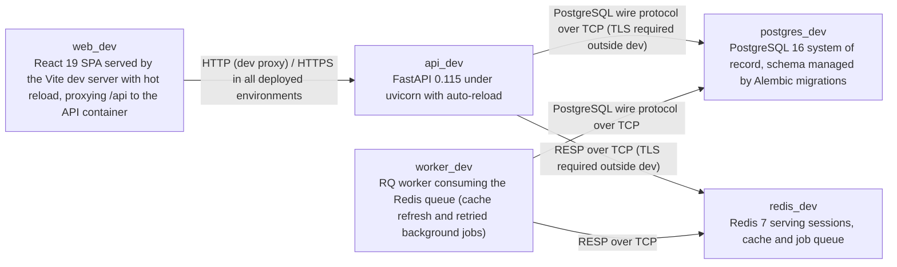

# Deployment Guide

> Maintained by QuorQ AI SDLC. Text between `sdlc:auto` markers is regenerated; anything outside them is yours and is kept.

<!-- sdlc:auto:start how-it-deploys -->
Pushes to `main` run `.github/workflows/deploy.yml`, which builds the API image (if there is a backend) and deploys the SPA to AWS Amplify. Commits touching only `docs/sdlc/**` don't deploy. Deployments can also be started from the platform's Deployment tab.
<!-- sdlc:auto:end how-it-deploys -->

<!-- sdlc:auto:start environments -->
| Name | Service | Runtime | Scaling | Environment |
|---|---|---|---|---|
| web_dev | React 19 SPA served by the Vite dev server with hot reload, proxying /api to the API container | Node 20 container (build output is static files) | single instance | dev |
| api_dev | FastAPI 0.115 under uvicorn with auto-reload | Python 3.12 container | single instance, 2 workers | dev |
| worker_dev | RQ worker consuming the Redis queue (cache refresh and retried background jobs) | Python 3.12 container, same image as api_dev | single instance | dev |
| postgres_dev | PostgreSQL 16 system of record, schema managed by Alembic migrations | postgres:16 container with a named volume | single instance | dev |
| redis_dev | Redis 7 serving sessions, cache and job queue | redis:7-alpine container, port 6379 | single instance | dev |
<!-- sdlc:auto:end environments -->

<!-- sdlc:auto:start live -->
**Frontend URL:** https://p0b51fe7c3507.d13el1ykvx8z63.amplifyapp.com

**Backend URL:** https://184-198-241-75.sslip.io/apps/0b51fe7c3507/

**Database:** PostgreSQL · app

**Version:** 751d51135a62

**Commit:** `751d511`

**Finished:** 2026-11-03
<!-- sdlc:auto:end live -->

<!-- sdlc:auto:start topology -->

<!-- sdlc:auto:end topology -->
